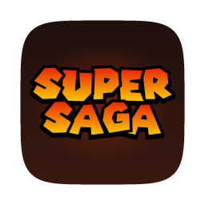
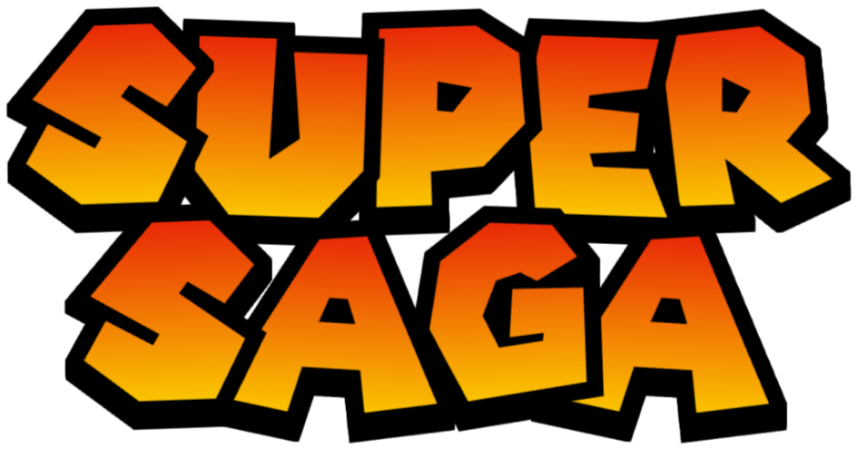

<p align="center">
  
</p>

<p align="center">
  
</p>

<p align="center">
  Play <b>Mario &amp; Luigi: Superstar Saga</b> natively on macOS, Windows and Linux.
</p>

<p align="center">
  <a href="https://github.com/sweatyeggs69/SuperSaga/actions/workflows/build.yml"></a>
  <a href="https://github.com/sweatyeggs69/SuperSaga/releases/latest"></a>
  <a href="LICENSE"></a>
  
</p>

> [!IMPORTANT]
> SuperSaga does not include the game. You need your own legally dumped ROM of
> **Mario & Luigi: Superstar Saga (USA)**. SuperSaga is an unofficial fan project, not affiliated with, endorsed or
> sponsored by Nintendo. Mario, Luigi and all related names are trademarks of their respective owners.

## Download

<a href="https://recomplauncher.com/game/supersaga"></a>

Or get the latest version for your system from the [Releases page](https://github.com/sweatyeggs69/SuperSaga/releases/latest).

## Getting started

1. **Open SuperSaga** and click **Choose ROM...** to pick your dump. Only the USA release (game code
   `A88E`, revision 0) is supported; other regions, revisions, hacks and damaged dumps are refused.
   SuperSaga only remembers where the file is. It never copies, uploads or changes it.
2. **BIOS (optional).** No BIOS is needed. If you own a GBA BIOS dump, pick it in Settings > Game > BIOS
   to see the original boot animation.
3. **Press Play.** Next time, **Continue** picks up where you left off.

## Controls

| GBA      | Keyboard                  | Controller                        |
| -------- | ------------------------- | --------------------------------- |
| D-pad    | Arrow keys                | D-pad or left stick               |
| A        | X                         | A (bottom) or Y (top) face button |
| B        | Z                         | B (right) or X (left) face button |
| L / R    | A / S                     | Shoulder buttons or triggers      |
| Start    | Enter                     | Start                             |
| Select   | Backspace or Right Shift  | Back                              |

| Shortcut                | Keyboard            | Controller                |
| ----------------------- | ------------------- | ------------------------- |
| Settings menu           | F1 or Esc           |                           |
| Fullscreen              | F11                 |                           |
| Save state / load state | Page Up / Page Down | Back + R / Back + L       |
| Save to a new slot      | F9                  | Back + D-pad Up           |
| Previous / next slot    | F6 / F7             | Back + D-pad Left / Right |
| Fast forward (hold)     | Tab                 | Right stick click         |
| Rewind (hold)           | `` ` `` (backtick)    | Left stick click          |

Everything except F1, Esc and F11 can be rebound in F1 > Controls.

## Features

- **Settings menu (F1)** for display (scaling, 16:10 and 16:9 widescreen, screen effects), controls and more.
- **Keyboard and controllers**, with full remapping.
- **Save states**: ten slots with thumbnails. Quick save and load use Slot 1 unless you pick another.
- **Fast forward and rewind**: fast forward at 2x or 4x, rewind up to the last 10 seconds.
- **Cheats** (F1 > Cheats): infinite HP and BP for both brothers, and max coins.
- **RetroAchievements**, optional. Cheats, mods and rewind are off in hardcore mode.
- **Import saves** from RetroArch, mGBA, VBA-M and others.
- **Desktop shortcut** that starts the game directly (Settings > Game > Shortcut).
- **Automatic updates** from this repository's releases, with your OK, without touching your saves.

## Saves

Saves, save states and settings live in your user folder, never inside the app:

- macOS: `~/Library/Application Support/SuperSaga/SuperSaga/`
- Windows: `%APPDATA%\SuperSaga\SuperSaga\`
- Linux: `~/.local/share/SuperSaga/SuperSaga/`

Settings > States > **Show save folder** opens it.

## Building from source

You need CMake 3.24 or newer and a C++20 compiler. SDL3, Dear ImGui and the other libraries are
downloaded during configure. On Linux, install SDL3's usual build packages first (the Linux job in
[build.yml](.github/workflows/build.yml) lists them).

```sh
cmake -S . -B build -DCMAKE_BUILD_TYPE=Release
cmake --build build
./build/supersaga
```

## Contributing

Bug reports and pull requests are welcome. Keep game content out of the repository: no ROMs, BIOS
files, saves, save states, extracted assets or screenshots of the game.

## License

[MIT](LICENSE). Bundled open-source components and fonts are listed in
[THIRD_PARTY_NOTICES.md](THIRD_PARTY_NOTICES.md).
